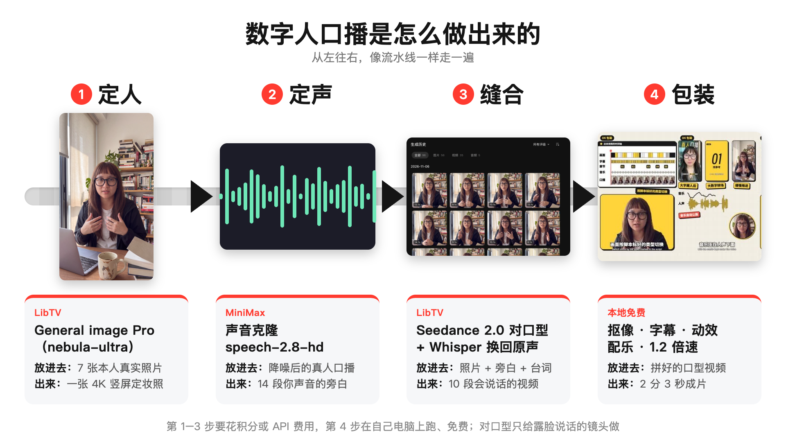
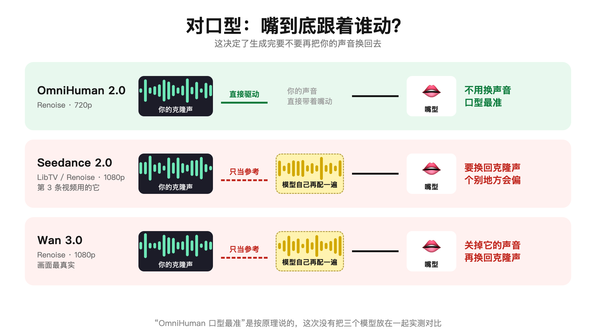
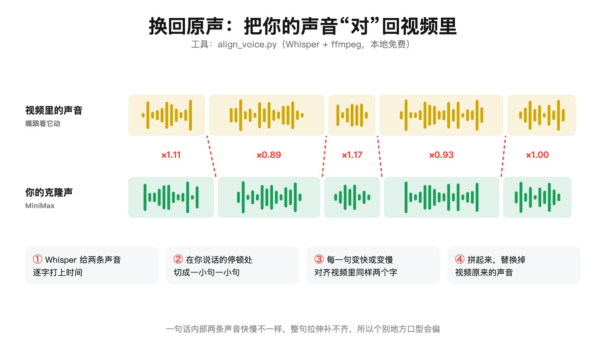
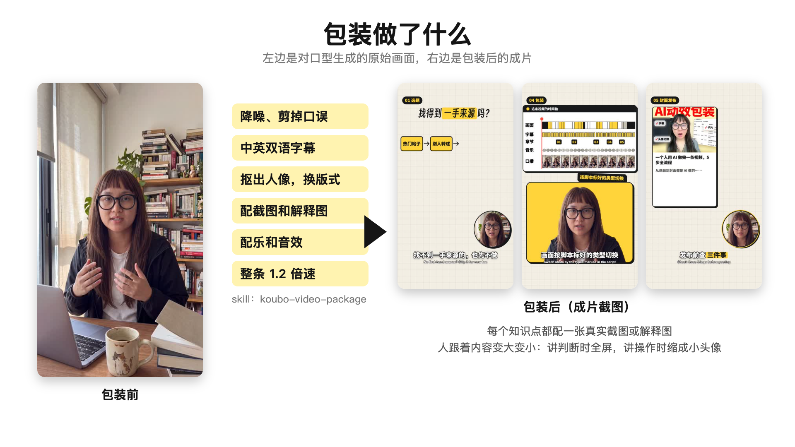

# 口播 AI 工作流 Skills

> 作者：阿星　｜　微信：**staraiwork**

一个人用 AI 做完一条口播短视频：从写脚本，到降噪、剪辑、字幕、抠像、动效、配乐、封面，再到用数字人代替真人出镜。

这里有两个 [Claude Code](https://claude.com/claude-code) skill，把我实际做视频的流程和踩过的坑都写进去了：

| Skill | 做什么 |
|---|---|
| `koubo-video-script` | 写口播脚本：快讯观点、工具教程、榜单盘点三种结构，每句标好画面类型 |
| `koubo-video-package` | 包装成片：降噪、粗剪、字幕、抠像、版式和动效、混音、封面、数字人 |


---

## 开始前要准备的东西

### 1. 必需

| 东西 | 用来做什么 | 怎么装 |
|---|---|---|
| macOS | 抠像、人脸跟踪、OCR 用的是系统自带的 Vision | — |
| Claude Code | 运行 skill | 见官网 |
| Xcode 命令行工具 | 编译 `seg` / `face` / `ocr` 三个小工具 | `xcode-select --install` |
| uv | 建独立的 Python 环境 | `brew install uv` |
| ffmpeg | 剪辑、混音 | `brew install ffmpeg` |
| Google Chrome | 逐帧渲染画面、生成封面 | 官网下载 |
| 字体：思源黑体、得意黑（Smiley Sans） | 字幕和大字 | 下载后双击安装 |

装好后运行一次（会下载 PyTorch 和语音识别模型，第一次比较慢）：

```bash
bash skills/koubo-video-package/scripts/setup.sh
```

所有依赖都装在 `~/.cache/koubo-video`，不会碰你的全局 Python。

### 2. 你自己的素材

| 东西 | 说明 |
|---|---|
| 口播原片 | 手机竖拍 9:16，人离镜头远一点，背景不要太杂。念错了停一下重说，不用从头来 |
| 背景音乐 | 自己找有授权的 |
| 音效 | 推荐 [Kenney Interface Sounds](https://kenney.nl/assets/interface-sounds)（CC0，免费商用），解压后把 `.ogg` 所在文件夹路径告诉 Claude |
| 录屏、截图 | 视频里讲到的操作，越真实越好 |

### 3. API Key 和账号（只有用到对应功能才需要）

| 功能 | 需要什么 | 在哪获取 | 怎么配置 |
|---|---|---|---|
| 数字人：克隆你的声音 | MiniMax API Key | [MiniMax 开放平台](https://platform.minimaxi.com)（国内）或 minimax.io（海外），注册后在“接口密钥”里创建，需要充值 | `export MINIMAX_API_KEY=你的key` |
| 数字人：定妆照 + 对口型 | Renoise 或 LibTV 账号（按积分计费） | 在各自官网注册充值，然后在 Claude Code 里接上它们的 MCP 连接器 | 按平台说明接入 |
| 封面：AI 生图（可选） | OpenAI 或兼容接口的 Key | OpenAI 平台或你用的中转服务 | `export OPENAI_API_KEY=...`，用中转时再配 `OPENAI_BASE_URL` |

不做数字人、不用 AI 生图封面的话，**一个 key 都不需要**，全部在本地跑。

Key 只放在环境变量里，可以照着 `.env.example` 写进你自己的 `~/.zshrc`。**不要把 key 写进仓库。**

### 4. 第一次用时填好你的设定

两个 `SKILL.md` 开头都有一张“创作者设定”表，标着【待填】：名字、结尾署名、发布平台、主色、外貌要点等。

不用自己去改：第一次用时 Claude 会问你，然后自动写回去。

---

## 安装

```bash
git clone https://github.com/seeyouintokyo/koubo-ai-skills.git
mkdir -p ~/.claude/skills
ln -s "$PWD/koubo-ai-skills/skills/koubo-video-script" ~/.claude/skills/
ln -s "$PWD/koubo-ai-skills/skills/koubo-video-package" ~/.claude/skills/
```

## 怎么用

在 Claude Code 里直接说人话，比如：

- “帮我把这篇文章写成 90 秒的工具教程口播脚本”
- “包装一下 `原片/02.mp4`，素材在 `素材/02/`，背景音乐用 `bgm.mp3`”
- “拆一下这几个对标视频的剪辑风格”
- “这条不想真人出镜，用数字人做”
- “给这条做个封面”

每一步需要你确认的地方（降噪选哪版、抠像边缘、样帧、封面），Claude 会先停下来给你看。

## 数字人怎么做（简版）



1. **声音**：录 30 秒以上的干净口播，降噪后用 MiniMax 克隆一次，以后台词直接合成你的声音。
2. **定妆照**：用你自己的 7 张左右真实照片做参考，一次生成 4K 竖屏。不要拿 AI 写真当参考，也不要在生成图上反复改。
3. **对口型**：

   | 模型 | 嘴跟着什么动 | 要不要换回你的声音 |
   |---|---|---|
   | OmniHuman 2.0 | 你给的音频 | 不用，口型最准 |
   | Seedance 2.0 / 2.5 | 模型自己配的声音 | 要，用 `align_voice.py` 按字对齐 |
   | Wan 3.0 | 模型自己生成 | 要 |

4. **省钱**：只给露脸说话的镜头做对口型，小头像用静态照片加动效。



用 Seedance 或 Wan 时，要把你的声音换回去：



## 包装做了什么



详细规则见 `skills/koubo-video-package/references/avatar.md`。

## 目录

```
skills/
  koubo-video-script/      写脚本
  koubo-video-package/
    SKILL.md               包装流程
    references/            风格、素材、封面、数字人、拆对标的规则
    scripts/               转写、降噪、粗剪、抠像、渲染、混音、录屏打码
    template/              画面引擎（HTML 逐帧渲染）
    cover/                 封面合成
    avatar/                声音克隆、换回原声
```

## 说明

- 这是我自己做视频时边做边沉淀的，目前用 2 条视频验证过，还在迭代。每做完一条，就把新踩的坑写回 skill 里。你用的时候也可以这样。
- 只在 macOS 上测过。
- 参考视频只拆手法，不抄画面；上屏前一律模糊，不标作者。

## License

MIT
